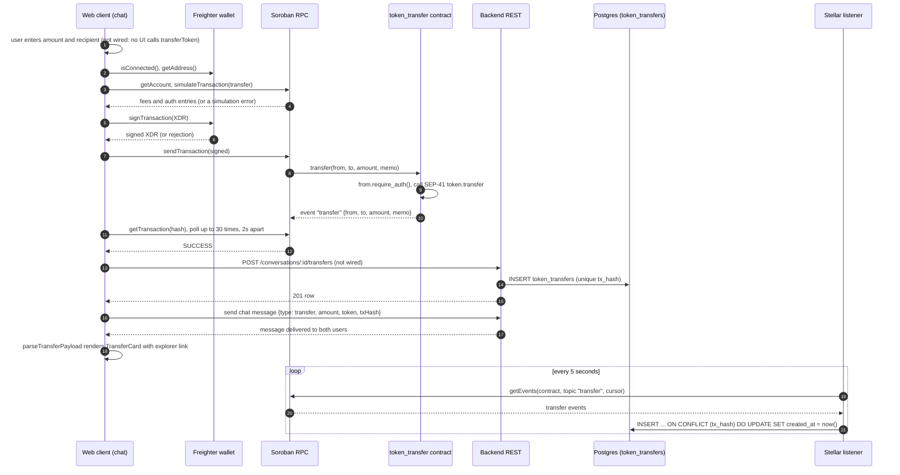

# Flow: in-chat token transfer, end to end

One sequence from "the user chooses to send tokens in a chat" to "both users see a transfer card". It spans the web app, Freighter, Soroban RPC, the `token_transfer` contract, the backend REST API, Postgres, and the Stellar listener.

This page describes what the code on `dev` does today. Where the intended flow and the code differ, it says so under [Gaps between the intended flow and the code](#gaps-between-the-intended-flow-and-the-code). Detail on each part lives in the linked pages and is not repeated here.

| Part               | Code                                                                                                 | Reference                                                                                                                                                    |
| ------------------ | ---------------------------------------------------------------------------------------------------- | ------------------------------------------------------------------------------------------------------------------------------------------------------------ |
| Transfer card      | `apps/web/src/components/chat/TransferCard.tsx`, rendered from `app/app/conversations/[id]/page.tsx` | [components-messaging.md](../../apps/web/docs/components-messaging.md)                                                                                       |
| Signing and submit | `apps/web/src/lib/soroban.ts` (`transferToken`)                                                      | [api-soroban-client.md](../../apps/web/docs/api-soroban-client.md)                                                                                           |
| Contract           | `contracts/contracts/token_transfer/src/lib.rs` (`transfer`)                                         | [api-token-transfer.md](../../contracts/docs/api-token-transfer.md), [concepts-token-transfer-flow.md](../../contracts/docs/concepts-token-transfer-flow.md) |
| REST               | `POST` and `GET /conversations/:id/transfers` in `apps/backend/src/routes/conversations.ts`          | [api-conversations.md](../../apps/backend/docs/api-conversations.md)                                                                                         |
| Table              | `tokenTransfers` in `apps/backend/src/db/schema.ts`                                                  | [contracts-database-schema.md](../../apps/backend/docs/contracts-database-schema.md)                                                                         |
| Listener           | `apps/backend/src/services/stellarListener.ts`                                                       | [concepts-stellar-listener.md](../../apps/backend/docs/concepts-stellar-listener.md)                                                                         |

## Sequence

Solid arrows are implemented. Steps marked **(not wired)** have working code on one side and no caller on the other.

## Step by step

1. **Start.** The flow begins when the user confirms a transfer in the chat. There is no such control on `dev` today (see [gaps](#gaps-between-the-intended-flow-and-the-code)), so step 1 is the caller's job.
2. **Check the wallet.** `transferToken(recipient, amount, memo)` imports `@stellar/freighter-api` lazily. `isConnected()` must be true and `getAddress()` must return a public key, otherwise it throws `Freighter not installed or not connected` or `Unable to read Freighter wallet address`.
3. **Build and simulate.** It builds a `transfer(from, to, amount, memo)` invocation against `NEXT_PUBLIC_TOKEN_TRANSFER_CONTRACT`, loads the account from `NEXT_PUBLIC_SOROBAN_RPC_URL`, and simulates. A simulation error is thrown with the RPC's message. Failing to set the contract variable leaves the placeholder `REPLACE_WITH_TOKEN_TRANSFER_CONTRACT_ID`, which makes every transfer fail here.
4. **Sign.** Freighter shows its approval popup. The private key never leaves the wallet.
5. **Submit.** The signed transaction goes to `sendTransaction`. Status `ERROR` throws `Transaction failed: …`.
6. **On-chain.** The contract requires `from`'s authorization, rejects `amount <= 0`, calls the underlying SEP-41 token's `transfer`, and publishes a `transfer` event containing `from`, `to`, `amount` and `memo` (bytes). Nothing is recorded if any step panics.
7. **Confirm.** The client polls `getTransaction(hash)` every 2 seconds, up to 30 times, and returns the hash on `SUCCESS`.
8. **Record.** The client is expected to `POST /conversations/:id/transfers` with `recipientAddress`, `amount`, `tokenContractId`, `txHash` and optional `memo` (snake_case names are also accepted). The backend checks membership, rejects a duplicate `txHash` with `409`, and inserts one row.
9. **Announce.** The client sends a chat message whose body is `{ type: 'transfer', amount, token, txHash }`. `page.tsx` calls `parseTransferPayload` on each message and renders a `TransferCard` for those that match. Both users see the same card because both receive the same message.
10. **Reconcile.** Independently of steps 8 and 9, the listener reads the contract's events and upserts on `tx_hash`.

## Source of truth

**The on-chain event is the source of truth. The backend row is a derived index.**

- The ledger is final and public. A transaction that succeeded has moved the tokens whether or not any backend row exists.
- The `token_transfers` row exists so the app can list a conversation's transfers without scanning the chain. It carries no authority.
- The chat message carrying the card is neither of these. It is a user-authored claim that points at a `txHash`, and the card does not check the chain when it renders.

### How the two are reconciled

Reconciliation is a keyed upsert, not a comparison:

| Case                                                      | Result                                                                                                                                                                                               |
| --------------------------------------------------------- | ---------------------------------------------------------------------------------------------------------------------------------------------------------------------------------------------------- |
| Client `POST` first, listener second (normal)             | The row already exists. The listener's upsert conflicts on `tx_hash` and **only sets `created_at = now()`**. Every other column keeps the client's values.                                           |
| Listener first, client `POST` second                      | The listener inserts the row. The client's `POST` finds the hash and returns `409 Transaction hash already exists`. The client's `conversationId`, `senderId` and `tokenContractId` are not applied. |
| Client `POST` only, no chain event (forged or wrong hash) | The row stays. **The backend never reads the chain on `POST`**, so nothing disproves it.                                                                                                             |
| Chain event only, client never `POST`s                    | The listener creates the row on its own, subject to the caveats below.                                                                                                                               |

When the row and the chain **disagree** (different amount, different recipient, hash that never confirmed), no code detects it or corrects it. The existing row wins for every column except `created_at`. Treat the chain as authoritative when investigating, and do not rely on `token_transfers` for anything that must be correct.

Caveats in the listener's insert path (`defaultPersistEvent`):

- `conversation_id` and `sender_id` come from decoding the event's `memo` as a message UUID and finding that message. If the memo is absent or does not match, the writer **falls back to an arbitrary existing conversation and user** (`limit(1)` with no ordering), and drops the event only if the database has none. A transfer created without a message-UUID memo can therefore be attributed to an unrelated conversation.
- `token_contract_id` is written as the literal `placeholder_token_contract_id`, not the real token.
- `recipient_address` and `amount` come from the event; `memo` is stored as the raw hex string.
- The listener's cursor lives in memory. After a restart it re-reads whatever the RPC still retains. Events older than the RPC retention window are not backfilled. See [concepts-stellar-listener.md](../../apps/backend/docs/concepts-stellar-listener.md).
- The listener only runs when both `STELLAR_RPC_URL` and `TOKEN_TRANSFER_CONTRACT_ID` are set, and `TOKEN_TRANSFER_CONTRACT_ID` must equal the web app's `NEXT_PUBLIC_TOKEN_TRANSFER_CONTRACT`.

## Failure points and what the user sees

"Sees" is what the code produces. `transferToken` throws an `Error`; the code that called it decides how to show that, and no caller exists on `dev`. The messages below are what that caller would receive.

| #   | Failure                                                      | Where               | Error thrown                                                                                                 | On-chain state                                   | Backend row                                                                            | What the user should see / what happens                                                                                                                                                                                    |
| --- | ------------------------------------------------------------ | ------------------- | ------------------------------------------------------------------------------------------------------------ | ------------------------------------------------ | -------------------------------------------------------------------------------------- | -------------------------------------------------------------------------------------------------------------------------------------------------------------------------------------------------------------------------- |
| 1   | Freighter missing or locked                                  | step 2              | `Freighter not installed or not connected`                                                                   | none                                             | none                                                                                   | Nothing was sent. Install or unlock the wallet, retry.                                                                                                                                                                     |
| 2   | Wrong or unset contract ID, bad amount, insufficient balance | step 3 (simulation) | the RPC's simulation error text                                                                              | none                                             | none                                                                                   | Nothing was sent. Fix configuration or amount.                                                                                                                                                                             |
| 3   | **User rejects in Freighter**                                | step 4              | `Unable to sign transaction with Freighter`                                                                  | none                                             | none                                                                                   | Nothing was sent and nothing is charged. The error message does not distinguish rejection from other signing errors.                                                                                                       |
| 4   | Freighter on the wrong network                               | step 4              | `Unable to sign transaction with Freighter`                                                                  | none                                             | none                                                                                   | The extension refuses a transaction built for a different passphrase. Align `NEXT_PUBLIC_NETWORK_PASSPHRASE`.                                                                                                              |
| 5   | RPC rejects the submission                                   | step 5              | `Transaction failed: …`                                                                                      | none                                             | none                                                                                   | Nothing moved. Retry.                                                                                                                                                                                                      |
| 6   | **Transaction fails on-chain** (reverts)                     | step 7              | **see note below**: surfaces as `Transaction not confirmed after timeout: <hash>` after about 60 seconds     | none (reverted)                                  | none                                                                                   | The tokens did not move, but the user waits a minute and is told it was "not confirmed", which suggests it might still land.                                                                                               |
| 7   | Confirmation poll times out                                  | step 7              | `Transaction not confirmed after timeout: <hash>`                                                            | **unknown**: it may still confirm after the 60 s | none (client stops)                                                                    | The hash in the message lets the user check the explorer. If it later succeeds, the listener will insert a row (see failure 8), but no chat card is sent.                                                                  |
| 8   | **Backend `POST` fails after on-chain success**              | step 8              | `4xx`/`5xx` from the API, or a network error                                                                 | **tokens moved**                                 | none from the client; **the listener inserts one** within about 5 seconds (if enabled) | The money moved but the chat has no card unless the client still sends the message. The row appears later via the listener, possibly attributed to the wrong conversation (see caveats). A retried `POST` then gets `409`. |
| 9   | `POST` returns `403` or `400`                                | step 8              | `Not a member of this conversation`, or `recipientAddress, amount, tokenContractId, and txHash are required` | tokens moved                                     | none from the client (listener may add it)                                             | Same recovery as failure 8.                                                                                                                                                                                                |
| 10  | Chat message fails to send after steps 7 and 8               | step 9              | message-send error                                                                                           | tokens moved                                     | row exists                                                                             | Recipient has no card even though the transfer is real and recorded. The sender can resend a message with the same `txHash`.                                                                                               |
| 11  | Listener disabled or RPC outage                              | step 10             | log line only                                                                                                | unaffected                                       | missing until the listener catches up                                                  | Rows from the client `POST` are unaffected. Chain-only transfers are not recorded while it is down.                                                                                                                        |

### Note on failure 6

`soroban.ts` throws `Transaction reverted: <hash>` when the polled status is `FAILED`, but that `throw` sits inside the same `try` whose `catch {}` is meant to swallow transient lookup errors. The revert error is caught and ignored, the loop keeps polling a transaction that will never succeed, and the function ends with the timeout error. The practical result is the behavior in the table. Fixing it means rethrowing after the catch, which is outside this document.

### Making failures 7 to 10 safe to retry

Everything after the on-chain step is idempotent on `tx_hash`. A client can safely repeat the `POST` and treat `409` as "already recorded". Because the chain, not the row, is the truth, a retry should key on the hash and never submit a second transaction.

## What the backend can see

The chat message body is end-to-end encrypted for messages sent through `POST /messages`: the server stores per-device ciphertext envelopes. **A token transfer is not hidden by that.** Two separate things are visible to the backend:

**1. The `token_transfers` row (plaintext columns)**

| Column              | Visible | Notes                                                              |
| ------------------- | ------- | ------------------------------------------------------------------ |
| `conversation_id`   | yes     | Which conversation the transfer belongs to.                        |
| `sender_id`         | yes     | The authenticated user who called `POST`, or the listener's guess. |
| `recipient_address` | yes     | Stellar address of the recipient.                                  |
| `amount`            | yes     | Decimal string.                                                    |
| `token_contract_id` | yes     | Client-supplied, or the placeholder from the listener.             |
| `tx_hash`           | yes     | Unique key.                                                        |
| `memo`              | yes     | Whatever the client sent, or the raw hex of the on-chain memo.     |
| `created_at`        | yes     | Row insert time, refreshed by each listener upsert.                |

**2. The chain itself.** The `transfer` event (`from`, `to`, `amount`, `memo`) is public on Stellar, so anyone, including the backend, can read it regardless of what the app stores.

The consequences:

- The server can see who paid whom, how much, in which token, and in which conversation. End-to-end encryption protects what people **say**, not the **transfers** they make.
- Do not put message text or other private information in the `memo`. It is written on-chain and into the `token_transfers` row in the clear.
- The card payload `{ type: 'transfer', amount, token, txHash }` travels as a chat message and would be encrypted like any other message if sent through the encrypted path (`POST /messages`). That does not conceal the same facts, because they are also in the row and on-chain.
- The listener links a chain event to a conversation only through a message-UUID memo. A transfer with no such memo has no honest link to a conversation in the backend's data.

## Gaps between the intended flow and the code

Verified against the code on `dev` when this page was written:

1. **No UI triggers the flow.** `transferToken` has no caller in `apps/web/src`. [api-soroban-client.md](../../apps/web/docs/api-soroban-client.md) names `components/chat/MessageInput.tsx` (`handleConfirmTransfer`), but that component was removed in the commit that retired the legacy chat route. Only the rendering end (`TransferCard`) remains.
2. **No client code calls `POST` or `GET /conversations/:id/transfers`.** The endpoints exist and are tested, but the web app does not use them.
3. **The memo type does not match.** `transferToken` passes the memo as a Soroban `Symbol`, while the contract's `transfer` takes `memo: Bytes`. The listener also expects the memo to be a message UUID. Simulation is likely to reject the call until the types line up (not run against a live RPC).
4. **The card has no "confirmed" state.** `TransferCard` renders from the chat message and links to the explorer. It does not read `token_transfers` and has no pending, failed, or confirmed status. "Confirmed" today means only that the sender's client saw `SUCCESS` before sending the message.
5. **`POST` trusts the client.** It does not verify the hash on-chain, so a conversation member can record a transfer that never happened.
6. **The revert error is swallowed** (failure 6 above).

When these are fixed, update the sequence diagram and delete the matching row.
